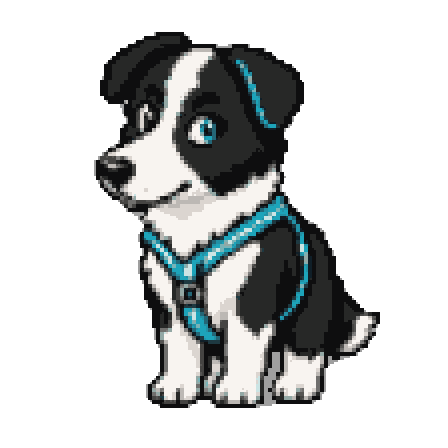

# Hi, I'm Alexandre Tostivint 👋

**Senior Cloud / Solutions Architect · AWS · FinOps · Automation**

I design cloud architectures. Most of my work is consulting and technical pre-sales: getting the trade-offs clear before anything gets built, then doing the infrastructure automation and cost optimization that keep the result usable. AWS is my main platform, alongside Azure and GCP.

I like building things, and I want to know how they actually work. What I learn usually gets written down somewhere.

## What I'm working on

- **Cloud architecture and FinOps:** infrastructure that holds up, Well-Architected reviews, and cost and operations decisions.
- **Kubernetes and GitOps:** several years of hands-on Kubernetes, with delivery through GitOps on Terraform, Ansible and Flux.
- **AI tooling:** plugins for Hermes Agent — agent memory, adaptive reasoning effort, and the desktop workflow I use every day.

## Hermes plugins

I build and publish plugins for [Hermes Agent](https://github.com/NousResearch/hermes-agent), listed on the [Hermes Marketplace](https://hermes-agent.nousresearch.com/marketplace). Each one does a single job, stays off until you enable it, writes nothing behind your back, and fails without taking anything else down with it.

- [**Hermes Adaptive Effort**](https://hermes-agent.nousresearch.com/marketplace/hermes-adaptive-effort): a separate scorer picks the reasoning effort for each request, from Jev, OpenAI Decisions, Cloudflare Clef, OpenRouter, or your own model. Off by default, fails open. ([GitHub](https://github.com/atostivint/hermes-adaptive-effort))
- [**Hermes Vitals Light**](https://hermes-agent.nousresearch.com/marketplace/hermes-vitals-light): CPU, load, free RAM, CPU pressure and round-trip time of the connected server, in the Desktop status bar, plus an optional TUI card. ([GitHub](https://github.com/atostivint/hermes-vitals-light))
- [**whoami**](https://hermes-agent.nousresearch.com/marketplace/whoami): a coloured pill in the composer showing which profile the next session will use. ([GitHub](https://github.com/atostivint/hermes-whoami))
- **Hermes Hindsight Plus**, experimental: injects Hindsight mental models into the first turn of a session. Work in progress, not release-ready. ([GitHub](https://github.com/atostivint/hermes-hindsight-plus))

## Tools I work with

**Cloud:** AWS · Azure · GCP  
**Infrastructure:** Terraform · CloudFormation · Ansible · Kubernetes · Docker · Flux  
**Automation:** Python · Bash · CI/CD  
**Architecture:** FinOps · AWS Well-Architected · serverless · security and governance

## Certifications

  
  
  
  
  
  

## Let's connect

Based near Rennes, France, working in French and English. I'm open to cloud architecture opportunities, consulting, and technical collaboration. A short message describing the problem is enough to start.

[Portfolio](https://alexandre.tostivint.bzh/) · [LinkedIn](https://www.linkedin.com/in/alexandretostivint/)

  

